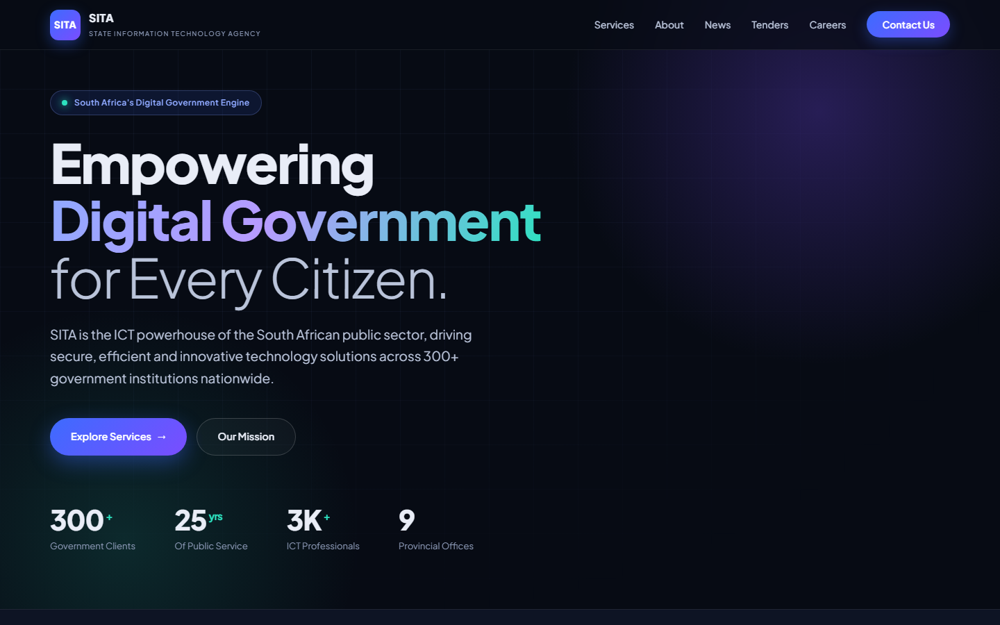
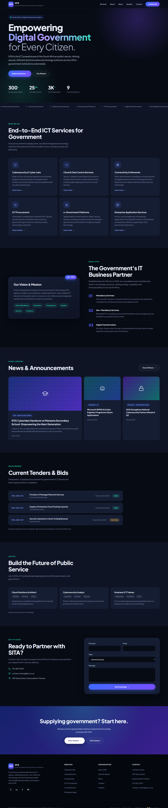
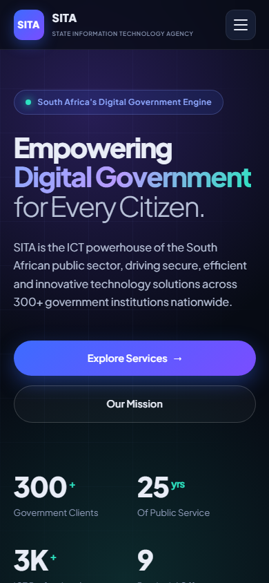

# SITA Website Rewrite

A modern redesign of the State Information Technology Agency (SITA) website. It is a single self-contained file, `index.html`, with no build step and no dependencies other than a Google Font.

Open `index.html` in any browser to view it.

## Preview

### Desktop

Full desktop page

### Mobile

  

Full mobile page

## What changed

**Design**
- New font: [Plus Jakarta Sans](https://fonts.google.com/specimen/Plus+Jakarta+Sans), replacing Poppins.
- New palette: deep ink background with electric blue and violet gradients and a mint accent, replacing navy and gold.
- Emoji icons replaced with crisp inline SVG icons.
- All em dashes removed from the copy, title and comments.

**Functionality**
- Every link now goes somewhere. Placeholder `#` links were replaced with section anchors, `tel:` and `mailto:` links, a map link and real social links.
- New **Tenders**, **Careers** and **Contact** sections so the nav items have destinations (listings are sample content).
- Working contact form with validation and an accessible success message (demo only, nothing is sent).
- "Learn more" links pre-select the matching topic in the contact form.
- Mobile hamburger menu that closes on link click, on `Esc` and when the window is widened.
- Active section highlight in the nav, animated stat counters and a back to top button.
- Ticker pauses on hover.

**Quality**
- Skip link, focus styles, ARIA labels and `prefers-reduced-motion` support.
- Fixed the empty `` in the provincial offices stat and the nested footer markup.
- Meta description and theme colour added.

## Notes

- Tender and job listings are placeholder content for the redesign.
- The contact form is a front-end demo with no backend.
